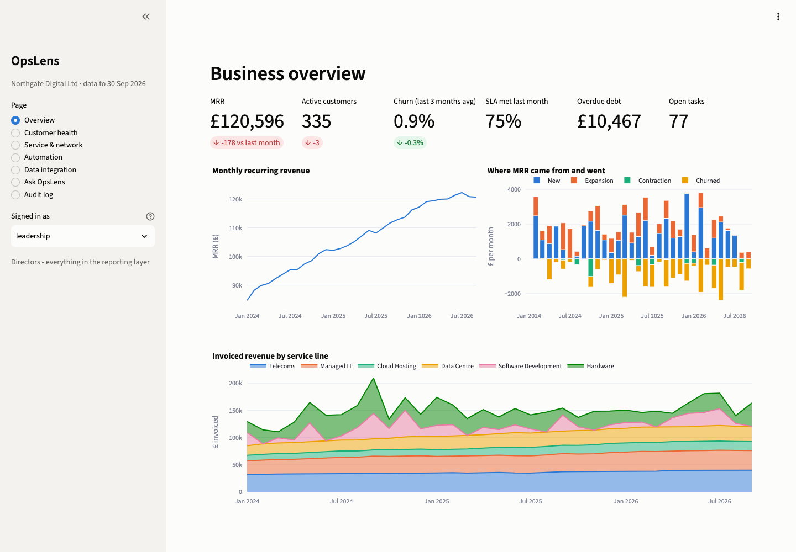
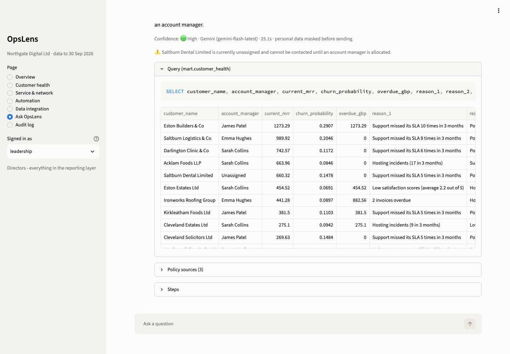
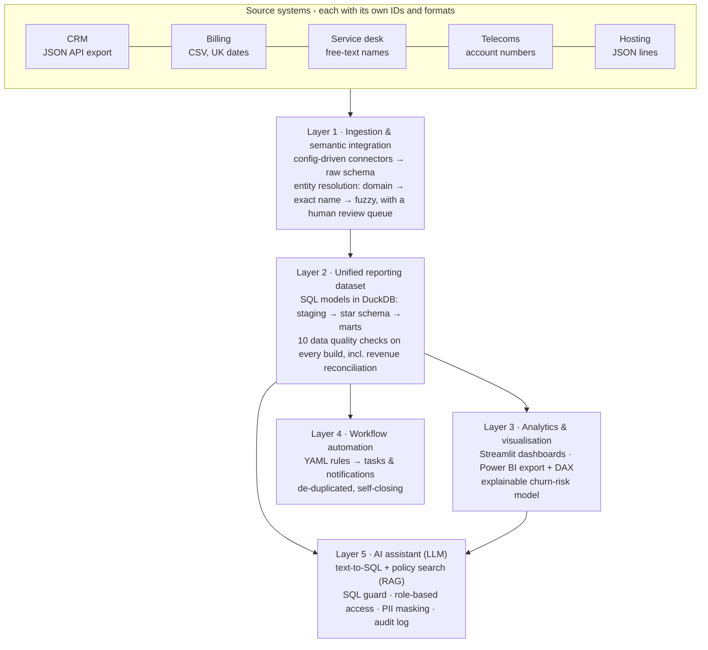
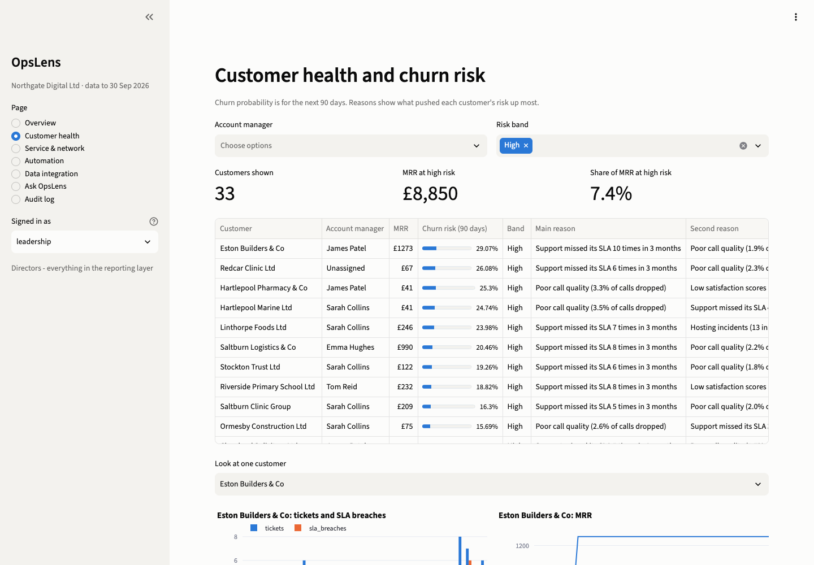
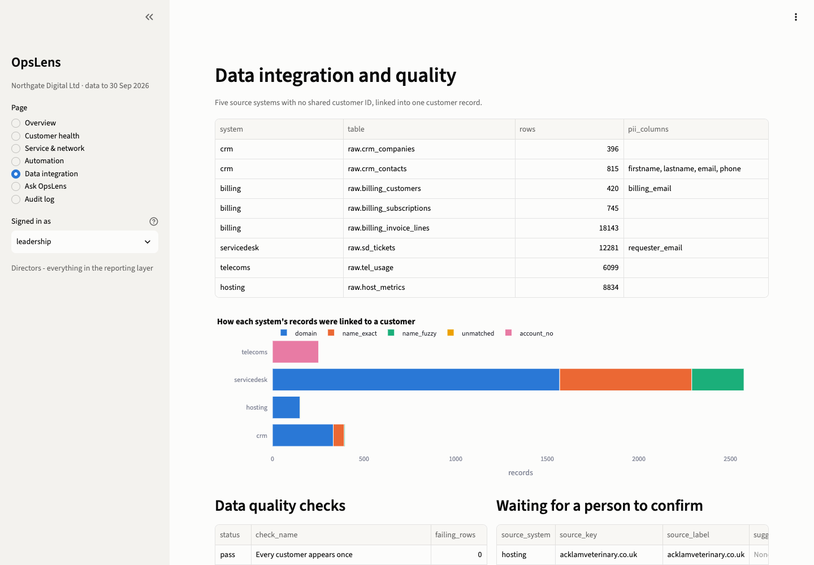
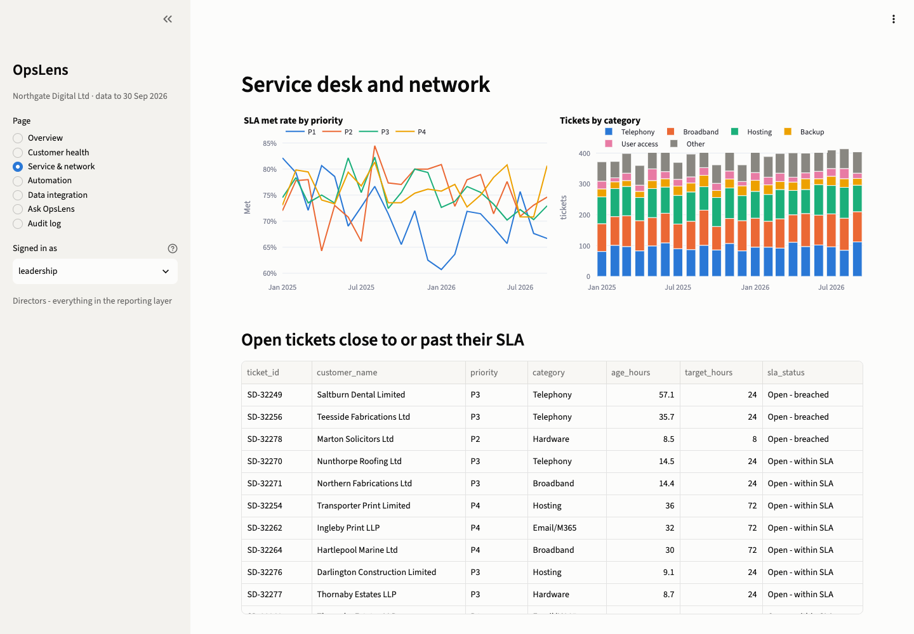
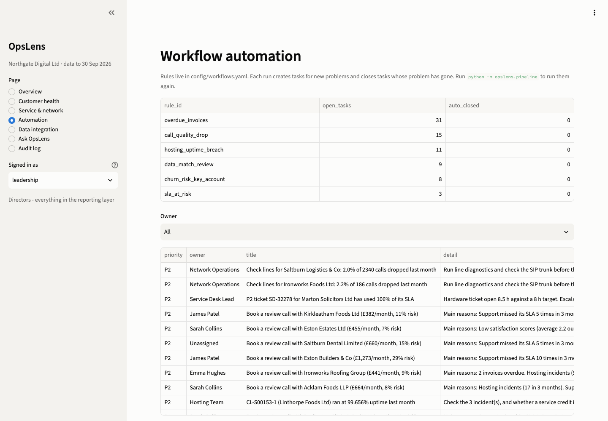

# OpsLens: an AI-assisted decision support platform for an IT & telecoms SME

OpsLens joins up the separate systems a small IT and telecoms company runs on
(CRM, billing, service desk, telecoms platform and hosting monitoring), turns
them into one trusted set of numbers, and puts four things on top: dashboards,
a churn-risk model that explains itself, rule-based workflow automation, and an
AI assistant that answers questions in plain English **and shows the evidence
behind every answer**.

It runs on *Northgate Digital Ltd*, a sample company whose five systems are
produced by a data generator (`opslens/sources/generate.py`).



**The AI assistant answering with its evidence** (the SQL it ran, the rows it used, the policy it cited):



## The problem it solves

In a typical 10-50 person IT services company, each system has its own idea of
who a customer is. Billing says `TEES ENGINEERING LIMITED`, the CRM says
`Tees Eng. Ltd`, the service desk says `tees engineering`, and the telecoms
platform only knows account `TV-500133`. Nobody can answer simple questions
like *"which of our biggest customers are unhappy?"* without a day in Excel.

## How it is built: five layers



| Layer | What it does | Where |
|---|---|---|
| **1. Ingestion & semantic integration** | Loads 5 systems through connectors defined in config (adding a system is a YAML entry, not new code). Links ~3,800 records to the right customer with no shared ID, recording *how* each link was made and *how sure* it is. Unsure matches go to a review queue instead of being guessed. | `config/sources.yaml`, `opslens/ingest/` |
| **2. Unified reporting dataset** | Plain SQL models build a star schema (customer, product, month; MRR, invoices, tickets, usage, hosting) and ready-made marts. Business rules (SLA targets, products) live in config. A build stops if any data quality check fails. | `opslens/warehouse/models/*.sql`, `config/business_rules.yaml` |
| **3. Analytics & visualisation** | Dashboards for revenue, customer health, service desk, network and data quality. The same star schema is exported for Power BI, with a DAX measure library and a build guide. A churn model ranks customers by risk and gives the reasons in plain words. | `app/`, `powerbi/`, `opslens/analytics/` |
| **4. Workflow automation** | Six rules (ticket about to breach SLA, key account at risk, overdue invoices, poor call quality, hosting uptime breach, record needs review) create tasks for a named owner. Running again never duplicates a task, and a task closes itself when its problem goes away. | `config/workflows.yaml`, `opslens/automation/` |
| **5. AI assistant** | Plans what evidence a question needs, writes SQL against the semantic layer, searches the policy documents, and answers only from that evidence, with citations and a confidence level. | `opslens/assistant/`, `config/semantic_layer.yaml` |

## Results

| | |
|---|---|
| Rows ingested from 5 source systems | 47,700 |
| Records linked to a customer automatically | 99.7% of service desk, 100% of CRM and telecoms, 99.3% of hosting |
| Accuracy of those links (checked against the generator's answer key) | 100% of tickets correct |
| Recurring invoices vs. MRR | reconcile to the penny, every month (a build check) |
| Churn model, tested on 12 later months it never saw | ROC AUC 0.75. The 10% of customers it ranks riskiest contain 35% of those who actually left within 90 days; 11% of them left, against 3.2% overall |
| Explainable model vs. gradient boosting benchmark | 0.75 vs 0.73 AUC, so nothing was lost by choosing the model that can explain itself |
| Automated tasks raised on the latest run | 77, across 6 rules |
| Tests | 27, covering matching accuracy, guard refusals, reconciliation, de-duplication and PII masking |

## Trust and governance

AI answers are only useful if people can check them and the business stays in
control of its data. So:

- **Evidence with every answer.** The SQL that ran, the rows it returned and the policy passages it used are shown under each answer. The model is told to answer only from them, and its confidence can never be higher than the evidence supports.
- **A SQL guard, not a prompt.** Every AI-written query is parsed with DuckDB's own parser: one SELECT only, only tables the user's role may read, no file access, run on a read-only connection, results capped. Tested against `DROP`, stacked statements, `read_csv`, raw tables and CTE tricks.
- **Role-based access.** Leadership, account managers, service desk and finance each see different tables (`config/access_policy.yaml`). Personal data stays in the raw layer, which no role can reach.
- **External vs self-hosted model is a setting.** Gemini (external API) or Ollama (runs on your own server). With an external model, emails, phone numbers and postcodes are masked before anything is sent. For a company with its own data centre, the self-hosted option means no data leaves its infrastructure.
- **Audit log.** Every question, role, model, SQL and source is logged.
- **People decide.** Automation creates tasks for named owners; it never puts an account on credit hold or sends anything to a customer by itself.

## Run it

```bash
python -m venv .venv && source .venv/bin/activate
pip install -r requirements.txt && pip install -e .

python -m opslens.pipeline --regenerate    # generate data → warehouse → model → rules → Power BI export
streamlit run app/streamlit_app.py         # dashboards and the AI assistant
python -m opslens.assistant.cli "Which high-risk customers pay us the most?"   # ask from the terminal
pytest                                     # 27 tests
```

For the AI assistant, copy `.env.example` to `.env` and either add a free
Gemini key ([aistudio.google.com/apikey](https://aistudio.google.com/apikey)),
or install [Ollama](https://ollama.com), run `ollama pull llama3.1:8b`, and set
`LLM_PROVIDER=ollama`.

Power BI: see [powerbi/README.md](powerbi/README.md) to build the report in the browser.

## Screenshots

| Customer health and churn risk | Data integration and quality |
|---|---|
|  |  |
| **Service desk and network** | **Workflow automation** |
|  |  |

## Design choices worth explaining

- **DuckDB + plain SQL** rather than a heavy platform: an SME can run the whole thing on one server, and anyone who knows SQL can read every model. The same models would move to Postgres, Fabric or Snowflake with small changes.
- **Billing as the customer master**: if we invoice you, you are a customer. Every other system is matched to billing, never to each other.
- **TF-IDF for document search**: with a few dozen policy passages it is instant, free and explainable. Switching to embeddings only touches `retriever.py`.
- **Generated data with a hidden cause**: each customer has an unseen "risk" that drives tickets, satisfaction, usage, late payment and leaving, so the model has a real but noisy signal, like real life, and the matching can be scored against an answer key.

## Limitations and next steps

- Real systems will be messier than the generated data, and the matching thresholds would need tuning on real records.
- Churn signal is modest (as it usually is). Next: add contract renewal dates and call-recording sentiment, and calibrate scores.
- Automation posts to Microsoft Teams via a webhook if configured; a production version would use Power Automate or an orchestrator (Prefect / Airflow) and two-way task sync with the service desk.
- Multi-tenant (SaaS) use would add a tenant ID to every table and row-level security, building on the per-customer isolation already in the matching layer.

---
Built by Mahum Maqbool · [github.com/mahum24](https://github.com/mahum24)
